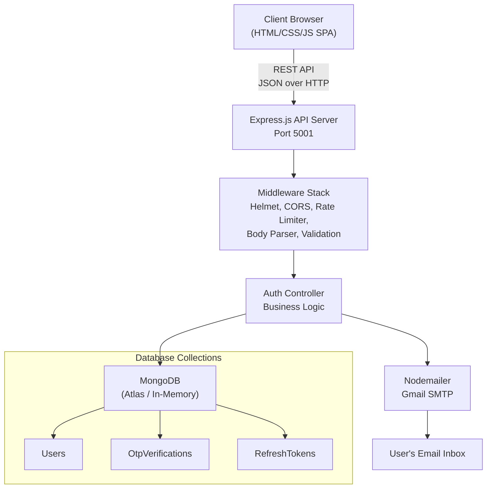
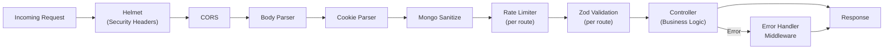
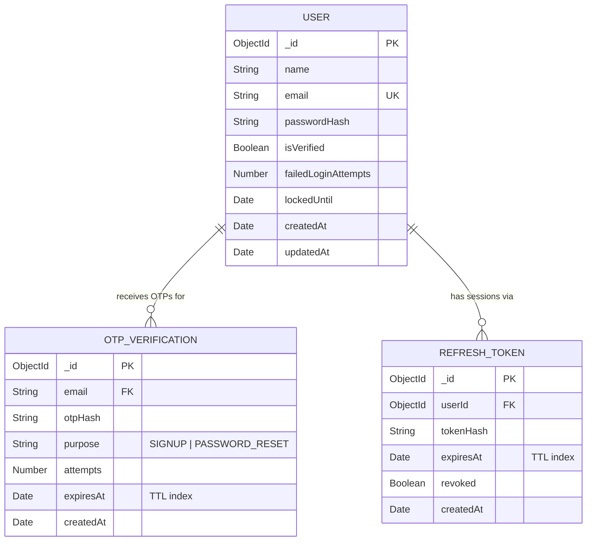
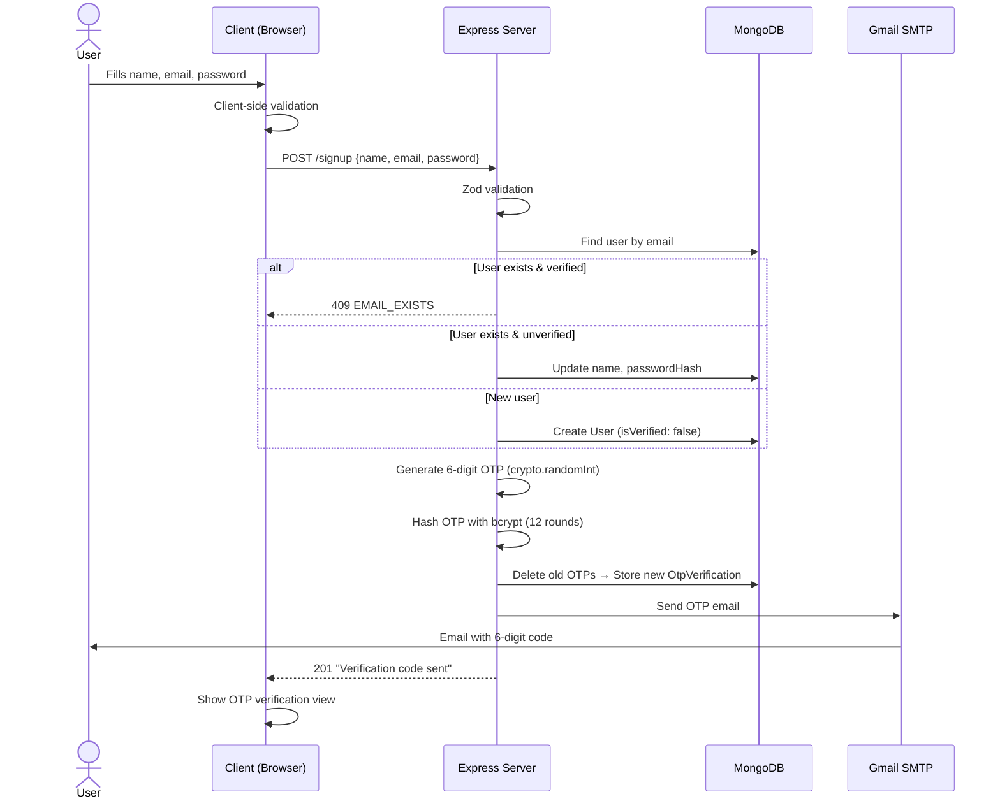
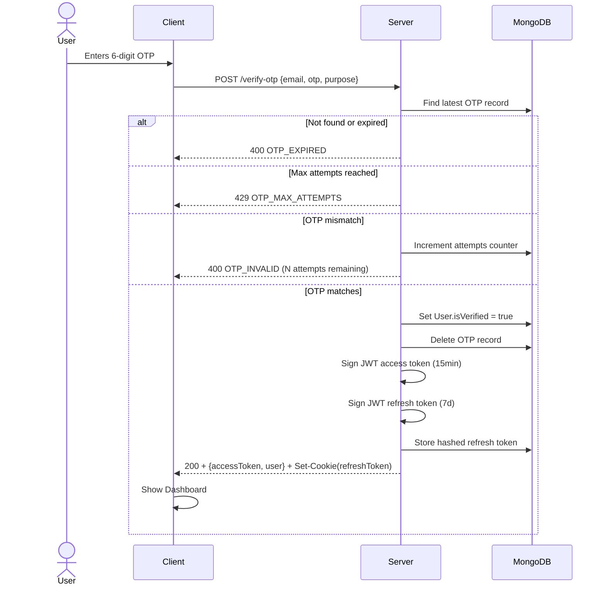
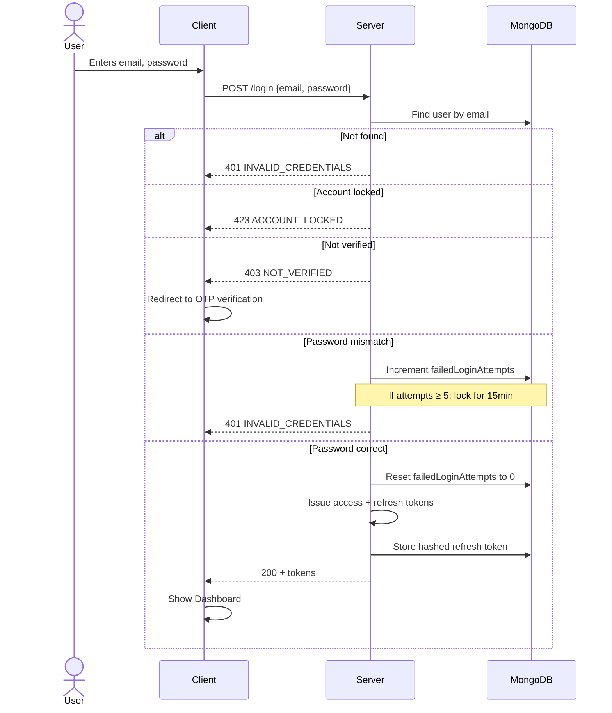
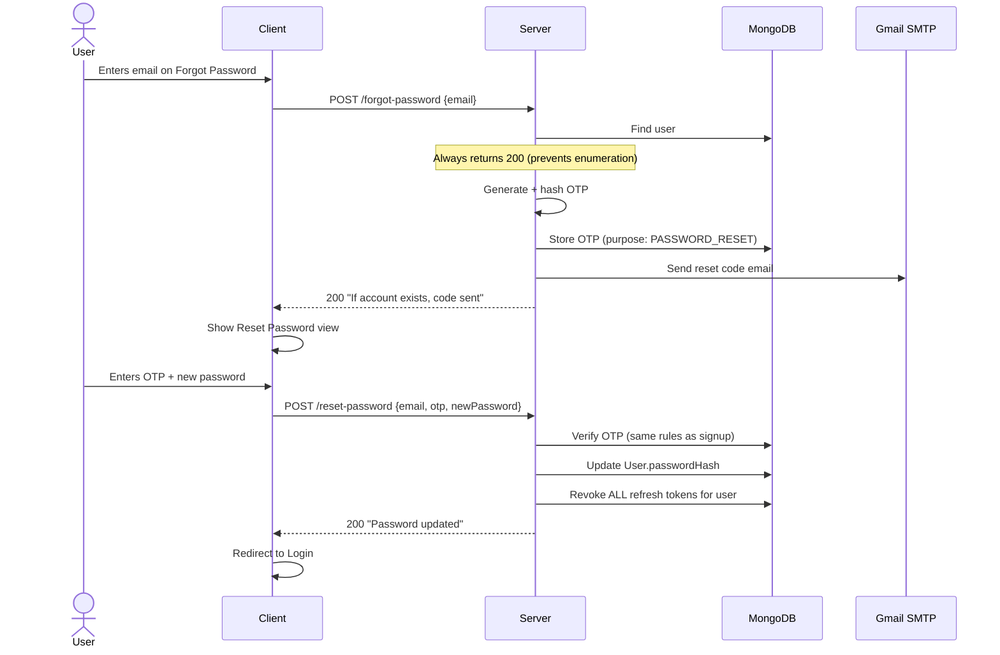
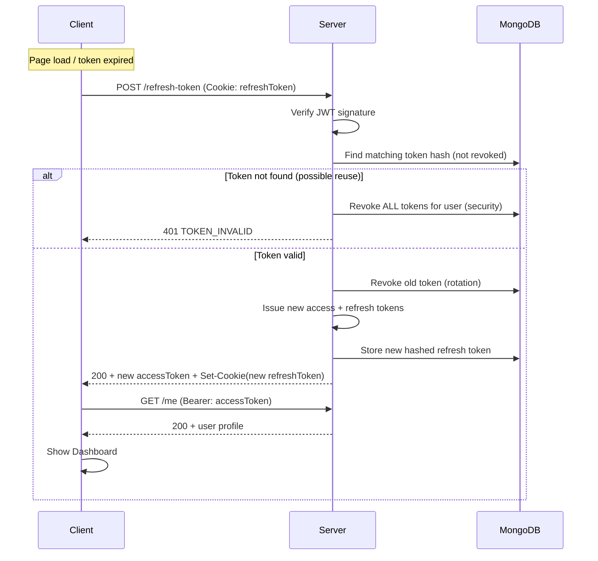
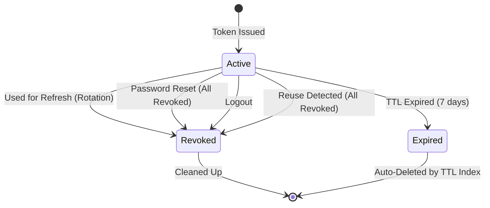

# OTP-Based Authentication System — Project Report

> **Author:** Aadarsh Parnar
> **Date:** November 2026
> **Version:** 1.0.0

---

## Table of Contents

1. [Abstract](#1-abstract)
2. [Introduction](#2-introduction)
3. [Problem Statement](#3-problem-statement)
4. [Objectives](#4-objectives)
5. [Scope of the Project](#5-scope-of-the-project)
6. [Literature Review](#6-literature-review)
7. [System Requirements](#7-system-requirements)
8. [System Architecture](#8-system-architecture)
9. [Technology Stack](#9-technology-stack)
10. [Database Design](#10-database-design)
11. [Module Description](#11-module-description)
12. [API Design & Contract](#12-api-design--contract)
13. [User Flow & Sequence Diagrams](#13-user-flow--sequence-diagrams)
14. [Security Implementation](#14-security-implementation)
15. [Frontend Design](#15-frontend-design)
16. [Code Implementation](#16-code-implementation)
17. [Testing](#17-testing)
18. [Screenshots](#18-screenshots)
19. [Future Enhancements](#19-future-enhancements)
20. [Conclusion](#20-conclusion)
21. [References](#21-references)

---

## 1. Abstract

This project implements a secure, full-stack **OTP (One-Time Password) based authentication system** with email verification. The system replaces traditional email-link-based account verification with a 6-digit OTP delivered via email, providing a more user-friendly and mobile-compatible verification experience. Built using **Node.js**, **Express.js**, **MongoDB**, and **vanilla JavaScript**, the system covers the complete authentication lifecycle — user registration with email verification, secure login with JWT-based session management, password recovery via OTP, and account lockout protection against brute-force attacks. All sensitive data — passwords, OTPs, and refresh tokens — are hashed using **bcrypt** before storage. The system employs multiple layers of security including rate limiting, input validation with Zod schemas, NoSQL injection prevention, secure HTTP headers via Helmet, and httpOnly cookie-based refresh token storage. The architecture follows a clean MVC pattern with separation of concerns, making it easily extensible and maintainable.

---

## 2. Introduction

### 2.1 Background

Authentication is the foundational layer of every web application. Traditional password-only systems are vulnerable to credential stuffing, phishing, and account takeover attacks. OTP-based verification adds a critical second layer that **proves email ownership** and protects sensitive actions like account creation and password reset.

### 2.2 Motivation

- **Email Verification:** Confirms users own the email address they register with, eliminating fake/typo signups.
- **Cost-Effective:** Unlike SMS-based OTPs, email OTPs have zero marginal cost using Gmail SMTP.
- **User Familiarity:** Users are accustomed to the OTP pattern from banking, e-commerce, and social media applications.
- **Security Enhancement:** Adds a knowledge-based second factor for sensitive operations without requiring additional hardware or apps.

### 2.3 Project Overview

The OTP Auth System is a full-stack web application consisting of:
- A **RESTful API server** handling all authentication logic
- A **responsive single-page frontend** with views for Sign Up, OTP Verification, Login, Forgot Password, Reset Password, and Dashboard
- An **email delivery system** using Gmail SMTP for OTP distribution
- A **MongoDB database** for persistent user data and token/OTP management

---

## 3. Problem Statement

Design and implement a secure authentication system that:
1. Verifies user email ownership through OTP delivery before granting access.
2. Provides secure JWT-based session management with access and refresh token rotation.
3. Protects against common attack vectors including brute-force attacks, credential stuffing, NoSQL injection, and user enumeration.
4. Supports the complete authentication lifecycle: Sign Up → Verify → Login → Forgot Password → Reset Password → Logout.
5. Delivers a polished, responsive user interface with real-time validation and feedback.

---

## 4. Objectives

| # | Objective | Status |
|---|-----------|--------|
| 1 | Implement user registration with email + password | ✅ Done |
| 2 | Generate cryptographically secure 6-digit OTPs | ✅ Done |
| 3 | Send OTP via email (Gmail SMTP / Nodemailer) | ✅ Done |
| 4 | Verify OTP with attempt limiting and expiry | ✅ Done |
| 5 | Implement JWT access + refresh token authentication | ✅ Done |
| 6 | Implement refresh token rotation for security | ✅ Done |
| 7 | Build forgot password and reset password flows | ✅ Done |
| 8 | Implement brute-force protection (account lockout) | ✅ Done |
| 9 | Add rate limiting on all auth endpoints | ✅ Done |
| 10 | Build a responsive, production-quality frontend | ✅ Done |
| 11 | Prevent common security vulnerabilities (XSS, NoSQL injection, CSRF) | ✅ Done |
| 12 | Hash all sensitive data (passwords, OTPs, tokens) | ✅ Done |

---

## 5. Scope of the Project

### 5.1 In Scope

- User registration with name, email, and password
- Email-based OTP verification for signup
- Secure login with JWT token issuance
- OTP resend with cooldown and hourly rate caps
- Forgot password flow with OTP verification
- Password reset with token revocation
- Refresh token rotation
- Account lockout after failed login attempts
- Responsive SPA frontend with all auth views
- In-memory MongoDB fallback for development

### 5.2 Out of Scope

- SMS/WhatsApp OTP delivery
- Social login (Google/Facebook OAuth)
- Admin panel / user management
- Email template customization UI
- Multi-factor authentication (TOTP/U2F)
- Payment or billing logic

---

## 6. Literature Review

### 6.1 OTP-Based Authentication

One-Time Passwords (OTPs) are widely recognized as a mechanism for verifying identity. NIST Special Publication 800-63B (Digital Identity Guidelines) recommends out-of-band verification via email or SMS as an acceptable method for account verification. The system implements NIST-aligned practices including:

- **Cryptographic OTP generation** using `crypto.randomInt()` instead of `Math.random()`.
- **Time-limited validity** (5-minute expiry window).
- **Attempt limiting** (maximum 5 attempts per OTP).
- **Hashed storage** — OTPs are never stored in plaintext.

### 6.2 JWT-Based Session Management

JSON Web Tokens (RFC 7519) provide a stateless authentication mechanism. This project implements the dual-token pattern:
- **Short-lived access tokens** (15 minutes) minimize the window of exposure if leaked.
- **Long-lived refresh tokens** (7 days), stored as hashed values in the database and delivered via httpOnly cookies, enable secure session persistence with the ability to revoke sessions.

### 6.3 Password Hashing

Bcrypt (Provos & Mazières, 1999) remains the industry standard for password hashing. The system uses **12 salt rounds**, balancing security against computational cost as recommended for production deployments in 2026.

### 6.4 Related Systems

| System | OTP Channel | Token Type | Key Difference |
|--------|------------|------------|----------------|
| Firebase Auth | Email link / SMS | Custom tokens | Managed service, no self-hosting |
| Auth0 | Email / SMS | Opaque tokens | SaaS-based, pricing per user |
| Passport.js | Pluggable | Session-based | Library, not a complete system |
| **This Project** | **Email** | **JWT (access + refresh)** | **Self-hosted, zero cost, full control** |

---

## 7. System Requirements

### 7.1 Hardware Requirements

| Component | Minimum | Recommended |
|-----------|---------|-------------|
| Processor | Dual-core 1.5 GHz | Quad-core 2.0+ GHz |
| RAM | 2 GB | 4+ GB |
| Storage | 500 MB | 1+ GB |
| Network | Broadband (for SMTP) | Broadband |

### 7.2 Software Requirements

| Software | Version | Purpose |
|----------|---------|---------|
| Node.js | v18+ | Runtime environment |
| npm | v9+ | Package management |
| MongoDB | v6+ (or in-memory fallback) | Database |
| Git | v2+ | Version control |
| Browser | Chrome 90+ / Firefox 90+ / Safari 15+ | Client |

### 7.3 Functional Requirements

1. **FR-1:** System shall allow users to register with name, email, and password.
2. **FR-2:** System shall send a 6-digit OTP to the user's email upon registration.
3. **FR-3:** System shall verify OTPs within a 5-minute validity window.
4. **FR-4:** System shall issue JWT access and refresh tokens upon successful verification.
5. **FR-5:** System shall allow authenticated users to view their profile.
6. **FR-6:** System shall provide password reset via email OTP.
7. **FR-7:** System shall lock accounts after 5 failed login attempts for 15 minutes.
8. **FR-8:** System shall allow users to sign out (revoking their refresh token).

### 7.4 Non-Functional Requirements

1. **NFR-1:** Auth endpoints shall respond in < 500ms (excluding email latency).
2. **NFR-2:** All passwords and OTPs shall be stored hashed, never in plaintext.
3. **NFR-3:** The system shall be stateless — all session state in JWT/database, enabling horizontal scaling.
4. **NFR-4:** Error messages on login/forgot-password shall not reveal whether an email is registered (preventing user enumeration).

---

## 8. System Architecture

### 8.1 High-Level Architecture Diagram



### 8.2 Component Responsibilities

| Component | Responsibility |
|-----------|---------------|
| **Client (SPA)** | View routing, form validation, API calls, session management |
| **Express Server** | HTTP request handling, middleware orchestration, static file serving |
| **Middlewares** | Security headers, CORS, rate limiting, input validation, authentication |
| **Controller** | Business logic: user flows, OTP lifecycle, token management |
| **Models** | Mongoose schemas, instance methods (e.g., `comparePassword`) |
| **Utils** | Pure functions: OTP generation, hashing, JWT signing/verifying |
| **Config** | Database connection, SMTP transporter initialization |

### 8.3 Request Processing Pipeline



---

## 9. Technology Stack

| Layer | Technology | Version | Purpose |
|-------|-----------|---------|---------|
| **Runtime** | Node.js | 18+ | Server-side JavaScript execution |
| **Framework** | Express.js | 4.21.2 | Web framework, routing, middleware |
| **Database** | MongoDB + Mongoose | 8.9.5 | Document database with ODM |
| **Dev Database** | mongodb-memory-server | 11.2.0 | In-memory MongoDB for development |
| **Authentication** | jsonwebtoken (JWT) | 9.0.2 | Token signing and verification |
| **Password Hashing** | bcrypt | 5.1.1 | Password and OTP hashing |
| **Email** | Nodemailer | 6.9.16 | SMTP email delivery |
| **Validation** | Zod | 3.24.1 | Runtime schema validation |
| **Security** | Helmet | 8.0.0 | Secure HTTP headers |
| **Security** | express-mongo-sanitize | 2.2.0 | NoSQL injection prevention |
| **Security** | express-rate-limit | 7.5.0 | Rate limiting |
| **Security** | cors | 2.8.5 | Cross-Origin Resource Sharing |
| **Utilities** | cookie-parser | 1.4.7 | Parse HTTP cookies |
| **Utilities** | dotenv | 16.4.7 | Environment variable management |
| **Logging** | pino | 9.6.0 | Structured JSON logging |
| **Testing** | Jest + Supertest | 29.7.0 / 7.0.0 | Unit and integration testing |
| **Dev Tools** | Nodemon | 3.1.9 | Auto-restart on file changes |
| **Frontend** | HTML5, CSS3, Vanilla JS | — | Responsive SPA |

---

## 10. Database Design

### 10.1 Entity-Relationship Diagram



### 10.2 Collection Schemas

#### Users Collection

| Field | Type | Constraints | Description |
|-------|------|-------------|-------------|
| `_id` | ObjectId | Primary Key | Auto-generated unique identifier |
| `name` | String | Required, trimmed | User's full name |
| `email` | String | Required, unique, lowercase, indexed | User's email address |
| `passwordHash` | String | Required | Bcrypt hash (12 rounds) |
| `isVerified` | Boolean | Default: `false` | Email verification status |
| `failedLoginAttempts` | Number | Default: `0` | Counter for brute-force protection |
| `lockedUntil` | Date | Default: `null` | Account lockout expiry timestamp |
| `createdAt` | Date | Auto | Mongoose timestamp |
| `updatedAt` | Date | Auto | Mongoose timestamp |

#### OtpVerifications Collection

| Field | Type | Constraints | Description |
|-------|------|-------------|-------------|
| `_id` | ObjectId | Primary Key | Auto-generated unique identifier |
| `email` | String | Required, indexed, lowercase | Target email address |
| `otpHash` | String | Required | Bcrypt hash of the 6-digit OTP |
| `purpose` | String | Enum: `SIGNUP`, `PASSWORD_RESET` | OTP purpose identifier |
| `attempts` | Number | Default: `0` | Verification attempt counter (max 5) |
| `expiresAt` | Date | Required, TTL index | Auto-deletes document after expiry |
| `createdAt` | Date | Auto | Mongoose timestamp |

#### RefreshTokens Collection

| Field | Type | Constraints | Description |
|-------|------|-------------|-------------|
| `_id` | ObjectId | Primary Key | Auto-generated unique identifier |
| `userId` | ObjectId | Required, indexed, ref: User | Owning user reference |
| `tokenHash` | String | Required | Bcrypt hash of the refresh token |
| `expiresAt` | Date | Required, TTL index | Auto-deletes after 7 days |
| `revoked` | Boolean | Default: `false` | Manual revocation flag |
| `createdAt` | Date | Auto | Mongoose timestamp |

### 10.3 Indexes

| Collection | Index | Type | Purpose |
|------------|-------|------|---------|
| Users | `email` | Unique | Fast lookup, prevent duplicates |
| OtpVerifications | `email` | Regular | Fast OTP lookup by email |
| OtpVerifications | `expiresAt` | TTL (expireAfterSeconds: 0) | Auto-cleanup of expired OTPs |
| RefreshTokens | `userId` | Regular | Fast token lookup per user |
| RefreshTokens | `expiresAt` | TTL (expireAfterSeconds: 0) | Auto-cleanup of expired tokens |

---

## 11. Module Description

### 11.1 Project Directory Structure

```
otp-auth-system/
├── client/                          # Frontend SPA
│   ├── index.html                   # Main HTML (all views)
│   ├── index.css                    # Styles (responsive, dark theme)
│   └── app.js                       # Client-side logic (631 lines)
│
├── server/                          # Backend API
│   ├── src/
│   │   ├── config/
│   │   │   ├── db.js                # MongoDB connection (with in-memory fallback)
│   │   │   └── mailer.js            # Nodemailer SMTP transporter
│   │   ├── controllers/
│   │   │   └── auth.controller.js   # All auth endpoint handlers (448 lines)
│   │   ├── middlewares/
│   │   │   ├── authenticate.js      # JWT Bearer token verification
│   │   │   ├── errorHandler.js      # Global error handler
│   │   │   ├── rateLimiter.js       # Rate limiting rules
│   │   │   └── validate.js          # Zod schema validation middleware
│   │   ├── models/
│   │   │   ├── User.js              # User schema
│   │   │   ├── OtpVerification.js   # OTP schema with TTL
│   │   │   └── RefreshToken.js      # Refresh token schema with TTL
│   │   ├── routes/
│   │   │   └── auth.routes.js       # Route definitions with middleware chains
│   │   ├── utils/
│   │   │   ├── generateOtp.js       # Cryptographic OTP generation
│   │   │   ├── hash.js              # Bcrypt hash/compare wrapper
│   │   │   ├── tokens.js            # JWT sign/verify functions
│   │   │   └── responseEnvelope.js  # Standardized API response format
│   │   ├── validators/
│   │   │   └── auth.validators.js   # Zod schemas for all endpoints
│   │   ├── app.js                   # Express app setup and middleware
│   │   └── server.js                # Entry point, DB connect, listen
│   ├── .env                         # Environment variables (not committed)
│   ├── .env.example                 # Template for environment setup
│   └── package.json                 # Dependencies and scripts
```

### 11.2 Module Details

#### Module 1: Configuration (`config/`)

- **db.js** — Establishes MongoDB connection with a smart fallback strategy: first attempts to connect to an external MongoDB instance, and if unavailable, automatically spins up a `mongodb-memory-server` in-memory instance for development.
- **mailer.js** — Initializes the Nodemailer SMTP transporter for Gmail. In development mode (or when credentials are not configured), falls back to logging OTPs to the console. Includes an HTML email template with a styled OTP display.

#### Module 2: Models (`models/`)

- **User.js** — Mongoose schema for user accounts. Includes an instance method `comparePassword()` for secure password verification via bcrypt.
- **OtpVerification.js** — Tracks OTP records with purpose enum (`SIGNUP` / `PASSWORD_RESET`), attempt counter, and a TTL index on `expiresAt` for automatic cleanup by MongoDB.
- **RefreshToken.js** — Stores hashed refresh tokens with user reference, revocation flag, and TTL-based auto-expiry.

#### Module 3: Controller (`controllers/`)

- **auth.controller.js** — The core business logic module (448 lines) implementing 8 endpoint handlers:
  - `signup` — Registration with OTP generation and email delivery
  - `verifyOtp` — OTP verification with attempt tracking
  - `resendOtp` — OTP resend with cooldown and hourly cap enforcement
  - `login` — Authentication with lockout protection
  - `forgotPassword` — OTP generation for password reset (enumeration-safe)
  - `resetPassword` — Password update with OTP verification and session revocation
  - `refreshToken` — Token rotation with reuse detection
  - `logout` — Session termination via token revocation
  - `me` — Protected endpoint returning user profile

#### Module 4: Middlewares (`middlewares/`)

- **authenticate.js** — Extracts and verifies JWT Bearer tokens from the `Authorization` header. Attaches `req.user` with `id` and `email` for downstream handlers.
- **errorHandler.js** — Global error handler that catches Mongoose duplicate key errors (11000), JWT errors, and Zod validation errors, returning appropriate error codes without leaking internal details.
- **rateLimiter.js** — Three rate limiting configurations:
  - `otpLimiter`: 5 requests/hour per email (OTP-related routes)
  - `loginLimiter`: 10 requests/15 minutes per IP
  - `generalLimiter`: 100 requests/15 minutes per IP
- **validate.js** — Generic middleware factory that validates `req.body` against any Zod schema, returning the first validation error in the standard envelope format.

#### Module 5: Utilities (`utils/`)

- **generateOtp.js** — Uses `crypto.randomInt()` for cryptographically secure 6-digit OTP generation with zero-padding.
- **hash.js** — Wraps bcrypt with 12 salt rounds for consistent hashing across passwords, OTPs, and tokens.
- **tokens.js** — JWT signing and verification for both access tokens (15min, includes `sub` and `email`) and refresh tokens (7 days, includes `sub` only).
- **responseEnvelope.js** — Ensures all API responses follow a consistent `{ success, message, data }` or `{ success, error: { code, message } }` structure.

#### Module 6: Validators (`validators/`)

- **auth.validators.js** — Six Zod schemas covering all endpoints:
  - `signupSchema`: name (1–100 chars), email (valid format), password (8–128 chars)
  - `verifyOtpSchema`: email, otp (exactly 6 digits, regex-validated), purpose (enum)
  - `resendOtpSchema`: email, purpose
  - `loginSchema`: email, password (non-empty)
  - `forgotPasswordSchema`: email
  - `resetPasswordSchema`: email, otp, newPassword (8–128 chars)

#### Module 7: Frontend Client (`client/`)

- **index.html** — Single HTML file containing all 6 views (Sign Up, Verify OTP, Login, Forgot Password, Reset Password, Dashboard) managed via CSS class toggling.
- **index.css** — Full styling with CSS custom properties, responsive grid layout, animated gradient orbs, smooth transitions, dark theme, and mobile-first design.
- **app.js** — 631-line IIFE implementing the complete client application: view routing, API wrapper with error handling, form validation, OTP input behavior (auto-advance, paste support, backspace navigation), password strength meter, resend countdown timers, session restoration via token refresh, and logout handling.

---

## 12. API Design & Contract

### 12.1 Base URL

```
/api/v1/auth
```

### 12.2 Response Envelope

All responses use a consistent JSON envelope:

```json
// Success
{ "success": true, "message": "...", "data": { } }

// Error
{ "success": false, "error": { "code": "ERROR_CODE", "message": "Human-readable message" } }
```

### 12.3 API Endpoints

| # | Method | Endpoint | Auth | Request Body | Success | Key Errors |
|---|--------|----------|------|-------------|---------|------------|
| 1 | `GET` | `/health` | No | — | `200` | — |
| 2 | `POST` | `/signup` | No | `{ name, email, password }` | `201` | `409` EMAIL_EXISTS, `400` VALIDATION_ERROR |
| 3 | `POST` | `/verify-otp` | No | `{ email, otp, purpose }` | `200` + tokens | `400` OTP_EXPIRED/OTP_INVALID, `429` OTP_MAX_ATTEMPTS |
| 4 | `POST` | `/resend-otp` | No | `{ email, purpose }` | `200` | `429` RESEND_COOLDOWN/RESEND_LIMIT |
| 5 | `POST` | `/login` | No | `{ email, password }` | `200` + tokens | `401` INVALID_CREDENTIALS, `403` NOT_VERIFIED, `423` ACCOUNT_LOCKED |
| 6 | `POST` | `/forgot-password` | No | `{ email }` | `200` (always) | — |
| 7 | `POST` | `/reset-password` | No | `{ email, otp, newPassword }` | `200` | `400` OTP_EXPIRED/OTP_INVALID |
| 8 | `POST` | `/refresh-token` | Cookie | — | `200` + new access token | `401` TOKEN_INVALID |
| 9 | `POST` | `/logout` | No | — | `200` | — |
| 10 | `GET` | `/me` | Bearer | — | `200` + user profile | `401` UNAUTHORIZED |

### 12.4 Error Codes Reference

| Code | HTTP Status | Meaning |
|------|-------------|---------|
| `VALIDATION_ERROR` | 400 | Request body failed Zod schema validation |
| `EMAIL_EXISTS` | 409 | Signup with an already-verified email |
| `INVALID_CREDENTIALS` | 401 | Wrong email or password on login |
| `NOT_VERIFIED` | 403 | Login attempt before email verification |
| `ACCOUNT_LOCKED` | 423 | Too many failed logins, temporarily locked |
| `OTP_EXPIRED` | 400 | No valid OTP found or OTP has expired |
| `OTP_INVALID` | 400 | Wrong OTP entered |
| `OTP_MAX_ATTEMPTS` | 429 | Too many wrong OTP tries on a single code |
| `RESEND_COOLDOWN` | 429 | Resend requested within 60-second cooldown |
| `RESEND_LIMIT` | 429 | Hourly OTP send cap exceeded (5/hour) |
| `RATE_LIMIT` | 429 | IP-based rate limit exceeded |
| `TOKEN_INVALID` | 401 | Invalid or expired JWT / refresh token |
| `UNAUTHORIZED` | 401 | Missing or invalid access token |
| `SERVER_ERROR` | 500 | Unhandled internal error |

---

## 13. User Flow & Sequence Diagrams

### 13.1 Sign Up Flow



### 13.2 OTP Verification Flow



### 13.3 Login Flow



### 13.4 Forgot / Reset Password Flow



### 13.5 Token Refresh & Session Restoration



---

## 14. Security Implementation

### 14.1 Security Measures Summary

| Security Concern | Implementation | File |
|-----------------|----------------|------|
| **Secure HTTP Headers** | `helmet()` middleware (CSP, HSTS, X-Frame-Options, etc.) | `app.js` |
| **CORS Policy** | Restricted to configured origin with credentials | `app.js` |
| **Input Validation** | Zod schemas on every endpoint | `validators/auth.validators.js` |
| **NoSQL Injection** | `express-mongo-sanitize` strips `$` and `.` from input | `app.js` |
| **Rate Limiting** | Per-email (OTP: 5/hr), per-IP (Login: 10/15min, General: 100/15min) | `middlewares/rateLimiter.js` |
| **Password Hashing** | Bcrypt with 12 salt rounds | `utils/hash.js` |
| **OTP Hashing** | Bcrypt (treated as a secret, same as passwords) | `utils/hash.js` |
| **Token Hashing** | Refresh tokens hashed before DB storage | `controllers/auth.controller.js` |
| **Secure Cookies** | `httpOnly`, `secure` (production), `sameSite: strict` | `controllers/auth.controller.js` |
| **Token Rotation** | Old refresh token revoked on every use | `controllers/auth.controller.js` |
| **Reuse Detection** | Unrecognized refresh token → revoke ALL user sessions | `controllers/auth.controller.js` |
| **User Enumeration Prevention** | Generic messages on login failure and forgot-password | `controllers/auth.controller.js` |
| **Account Lockout** | 5 failed logins → 15-minute lock | `controllers/auth.controller.js` |
| **OTP Attempt Limiting** | Max 5 attempts per OTP, then invalidated | `controllers/auth.controller.js` |
| **OTP Cooldown** | 60-second minimum between resend requests | `controllers/auth.controller.js` |
| **OTP Hourly Cap** | Max 5 OTPs per email per hour | `controllers/auth.controller.js` |
| **Session Revocation** | All refresh tokens revoked on password reset | `controllers/auth.controller.js` |
| **Short-Lived Tokens** | Access token expires in 15 minutes | `utils/tokens.js` |
| **Error Sanitization** | Stack traces hidden in production, secrets never logged | `middlewares/errorHandler.js` |
| **Password Policy** | Min 8 chars, cannot equal email local part | `validators/auth.validators.js`, `auth.controller.js` |
| **Cryptographic OTP** | `crypto.randomInt()` (not `Math.random()`) | `utils/generateOtp.js` |

### 14.2 Refresh Token Rotation Diagram



---

## 15. Frontend Design

### 15.1 Views / Screens

The frontend is built as a **Single Page Application (SPA)** using vanilla HTML, CSS, and JavaScript — no frameworks. All six views are embedded in a single HTML file and shown/hidden via CSS class toggling.

| # | View | Purpose | Key Features |
|---|------|---------|--------------|
| 1 | **Sign Up** | User registration | Name, email, password fields; password strength meter; toggle visibility |
| 2 | **Verify OTP** | Email verification | 6 individual digit inputs; auto-advance; paste support; resend with countdown |
| 3 | **Sign In** | User login | Email, password fields; forgot password link; unverified redirect |
| 4 | **Forgot Password** | Request reset code | Email field; generic success message |
| 5 | **Reset Password** | Set new password | OTP input + new password + confirm; password strength meter; resend option |
| 6 | **Dashboard** | Authenticated home | Welcome greeting, user details, verified badge, sign out |

### 15.2 UI Features

- **Responsive Layout:** Split-screen design on desktop (hero + form), stacked on mobile
- **Animated Background:** CSS gradient orbs with floating animations
- **Password Strength Meter:** Real-time strength indicator (Weak → Fair → Good → Strong) based on length, case mix, digits, and special characters
- **OTP Input UX:** Individual digit boxes with auto-advance on input, backspace navigation, full paste support, filled/error visual states
- **Loading States:** Button spinner animations during API calls with disabled state
- **Alert System:** Success and error alerts with icons and smooth transitions
- **Password Toggle:** Eye icon to show/hide password fields
- **Session Persistence:** Automatic session restoration on page reload via refresh token
- **Dark Theme:** Elegant dark color palette with stone/warm neutrals

### 15.3 Client-Side Validation

All forms perform client-side validation before API calls:
- Email format check via regex
- Password minimum length (8 characters)
- OTP completeness (all 6 digits filled)
- Password confirmation match (on reset)
- Required field checks with per-field error messages

---

## 16. Code Implementation

### 16.1 OTP Generation

```javascript
// utils/generateOtp.js
const crypto = require("crypto");

function generateOtp() {
  return crypto.randomInt(0, 1000000).toString().padStart(6, "0");
}
```

> Uses Node.js built-in `crypto.randomInt()` which is cryptographically secure, unlike `Math.random()`. Zero-padding ensures codes like `004821` are preserved as valid 6-digit strings.

### 16.2 Password & OTP Hashing

```javascript
// utils/hash.js
const bcrypt = require("bcrypt");
const SALT_ROUNDS = 12;

module.exports = {
  hash: (value) => bcrypt.hash(value, SALT_ROUNDS),
  compare: (value, hash) => bcrypt.compare(value, hash),
};
```

> Bcrypt's `compare()` is **constant-time**, preventing timing attacks that could leak information about the stored hash.

### 16.3 JWT Token Management

```javascript
// utils/tokens.js
const jwt = require("jsonwebtoken");

function signAccessToken(user) {
  return jwt.sign(
    { sub: user._id, email: user.email },
    process.env.JWT_ACCESS_SECRET,
    { expiresIn: process.env.ACCESS_TOKEN_EXPIRY || "15m" }
  );
}

function signRefreshToken(user) {
  return jwt.sign(
    { sub: user._id },
    process.env.JWT_REFRESH_SECRET,
    { expiresIn: process.env.REFRESH_TOKEN_EXPIRY || "7d" }
  );
}
```

> Access and refresh tokens use **separate secrets** — compromising one doesn't compromise the other. Access tokens include the user's email for quick lookups; refresh tokens include only `sub` (user ID) to minimize payload.

### 16.4 Rate Limiting Configuration

```javascript
// middlewares/rateLimiter.js
const otpLimiter = rateLimit({
  windowMs: 60 * 60 * 1000,      // 1 hour
  max: 5,                          // 5 requests per window
  keyGenerator: (req) => req.body.email || req.ip,
});

const loginLimiter = rateLimit({
  windowMs: 15 * 60 * 1000,      // 15 minutes
  max: 10,                         // 10 login attempts per IP
});
```

### 16.5 Database Connection with Fallback

```javascript
// config/db.js — Smart fallback strategy
const connectDB = async () => {
  try {
    let uri = process.env.MONGO_URI;
    try {
      await mongoose.connect(uri, { serverSelectionTimeoutMS: 3000 });
      return; // External MongoDB connected
    } catch (err) {
      console.log("External MongoDB not available, starting in-memory server...");
    }

    // Fallback to mongodb-memory-server
    const { MongoMemoryServer } = require("mongodb-memory-server");
    mongoServer = await MongoMemoryServer.create();
    uri = mongoServer.getUri();
    await mongoose.connect(uri);
  } catch (err) {
    console.error("MongoDB connection error:", err.message);
    process.exit(1);
  }
};
```

### 16.6 Email Template

```javascript
// config/mailer.js — Styled HTML email with OTP
function otpEmailTemplate(otp, purpose) {
  const heading = purpose === "PASSWORD_RESET"
    ? "Reset your password"
    : "Verify your email";
  return {
    subject: heading,
    text: `Your code is ${otp}. It expires in 5 minutes.`,
    html: `<div style="font-family: 'Inter', sans-serif; max-width: 480px; ...">
      <h2>${heading}</h2>
      <span style="font-size: 36px; letter-spacing: 8px;">${otp}</span>
      <p>This code expires in 5 minutes.</p>
    </div>`,
  };
}
```

---

## 17. Testing

### 17.1 Testing Strategy

| Test Type | Tool | Coverage |
|-----------|------|----------|
| Unit Tests | Jest | Utility functions (OTP generation, hashing, tokens) |
| Integration Tests | Jest + Supertest | API endpoints (signup → verify → login flow) |
| Manual Testing | Browser + cURL | Full user journey, edge cases |

### 17.2 Test Execution

```bash
cd server
npm test    # Runs: jest --forceExit --detectOpenHandles
```

### 17.3 Test Cases Checklist

| # | Test Case | Expected Result |
|---|-----------|-----------------|
| 1 | Sign up with valid data | 201, OTP email sent |
| 2 | Sign up with existing verified email | 409 EMAIL_EXISTS |
| 3 | Sign up with invalid email format | 400 VALIDATION_ERROR |
| 4 | Sign up with password < 8 chars | 400 VALIDATION_ERROR |
| 5 | Verify OTP with correct code | 200, tokens issued, user verified |
| 6 | Verify OTP with wrong code | 400 OTP_INVALID, attempts decremented |
| 7 | Verify OTP after 5 wrong attempts | 429 OTP_MAX_ATTEMPTS |
| 8 | Verify OTP after expiry (5 min) | 400 OTP_EXPIRED |
| 9 | Resend OTP within cooldown (60s) | 429 RESEND_COOLDOWN |
| 10 | Resend OTP after hourly cap | 429 RESEND_LIMIT |
| 11 | Login with correct credentials | 200, tokens issued |
| 12 | Login with wrong password | 401 INVALID_CREDENTIALS |
| 13 | Login 5 wrong passwords → lockout | 423 ACCOUNT_LOCKED (15 min) |
| 14 | Login with unverified account | 403 NOT_VERIFIED |
| 15 | Forgot password (existing email) | 200 generic message + OTP sent |
| 16 | Forgot password (non-existing email) | 200 same generic message (no OTP) |
| 17 | Reset password with valid OTP | 200, password updated, tokens revoked |
| 18 | Refresh token (valid) | 200, new access token, old token rotated |
| 19 | Refresh token (reused/revoked) | 401, ALL user sessions revoked |
| 20 | Access `/me` with valid token | 200, user profile returned |
| 21 | Access `/me` without token | 401 UNAUTHORIZED |
| 22 | Logout | 200, refresh token revoked, cookie cleared |

---

## 18. Screenshots

> **Note:** Add screenshots of each view here:
> 1. Sign Up page
> 2. OTP Verification page (with OTP digits)
> 3. Login page
> 4. Forgot Password page
> 5. Reset Password page
> 6. Dashboard (authenticated)
> 7. Email received with OTP
> 8. Error states (validation, wrong OTP, account locked)
> 9. Mobile responsive view

---

## 19. Future Enhancements

| # | Enhancement | Priority | Effort |
|---|-------------|----------|--------|
| 1 | SMS/WhatsApp OTP delivery | High | Medium |
| 2 | Social login (Google OAuth, GitHub) | High | Medium |
| 3 | TOTP (authenticator app) support | Medium | Medium |
| 4 | Admin dashboard for user management | Medium | High |
| 5 | Email template customization | Low | Low |
| 6 | Redis-based rate limiting (for multi-instance) | Medium | Low |
| 7 | Account deletion / data export (GDPR) | High | Medium |
| 8 | Login activity log / session management UI | Medium | Medium |
| 9 | WebAuthn / Passkey support | Medium | High |
| 10 | Password change (authenticated) | Low | Low |
| 11 | Email change with re-verification | Medium | Medium |
| 12 | Docker containerization | Low | Low |
| 13 | CI/CD pipeline (GitHub Actions) | Medium | Low |
| 14 | Swagger/OpenAPI documentation | Low | Low |

---

## 20. Conclusion

The OTP-based Authentication System successfully implements a **secure, production-grade authentication solution** covering the complete user lifecycle from registration to password recovery. Key achievements include:

1. **Comprehensive Security:** Multiple layers of protection — bcrypt hashing, JWT rotation, rate limiting, account lockout, input validation, NoSQL injection prevention, and secure cookie management — collectively defend against the OWASP Top 10 authentication threats.

2. **User-Centric Design:** The OTP verification flow provides a familiar, accessible experience with thoughtful UX touches like auto-advancing OTP inputs, paste support, password strength feedback, and countdown timers for resend operations.

3. **Clean Architecture:** The MVC-based directory structure with separation of concerns (config, models, controllers, middlewares, validators, utils) ensures the codebase is maintainable, testable, and extensible.

4. **Zero-Cost Infrastructure:** By leveraging Gmail SMTP for email delivery and mongodb-memory-server for development, the entire system can be developed, tested, and demonstrated without any paid services.

5. **Standards Compliance:** The implementation follows NIST 800-63B guidelines for digital identity, RFC 7519 for JWT tokens, and industry best practices for password hashing and OTP management.

The project serves as a solid foundation that can be extended with additional authentication methods (social login, TOTP, WebAuthn), integrated into larger applications, or deployed to production with minimal configuration changes.

---

## 21. References

1. NIST Special Publication 800-63B — Digital Identity Guidelines: Authentication and Lifecycle Management. National Institute of Standards and Technology. https://pages.nist.gov/800-63-3/sp800-63b.html

2. RFC 7519 — JSON Web Token (JWT). Internet Engineering Task Force. https://tools.ietf.org/html/rfc7519

3. Provos, N. & Mazières, D. (1999). A Future-Adaptable Password Scheme. USENIX Annual Technical Conference. https://www.usenix.org/legacy/events/usenix99/provos/provos.pdf

4. OWASP Authentication Cheat Sheet. Open Web Application Security Project. https://cheatsheetseries.owasp.org/cheatsheets/Authentication_Cheat_Sheet.html

5. Express.js Documentation. https://expressjs.com/

6. Mongoose ODM Documentation. https://mongoosejs.com/docs/

7. Nodemailer Documentation. https://nodemailer.com/

8. Zod Documentation. https://zod.dev/

9. JSON Web Tokens Introduction. https://jwt.io/introduction/

10. bcrypt npm package. https://www.npmjs.com/package/bcrypt

---

> **Project Repository:** `otp-auth-system/`
> **Server Entry Point:** `server/src/server.js`
> **Run Command:** `cd server && npm start`
> **Default URL:** http://localhost:5001
